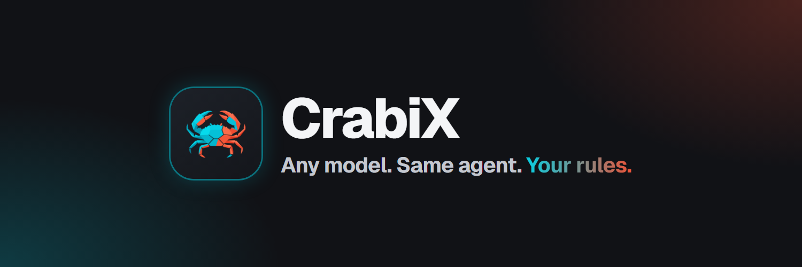
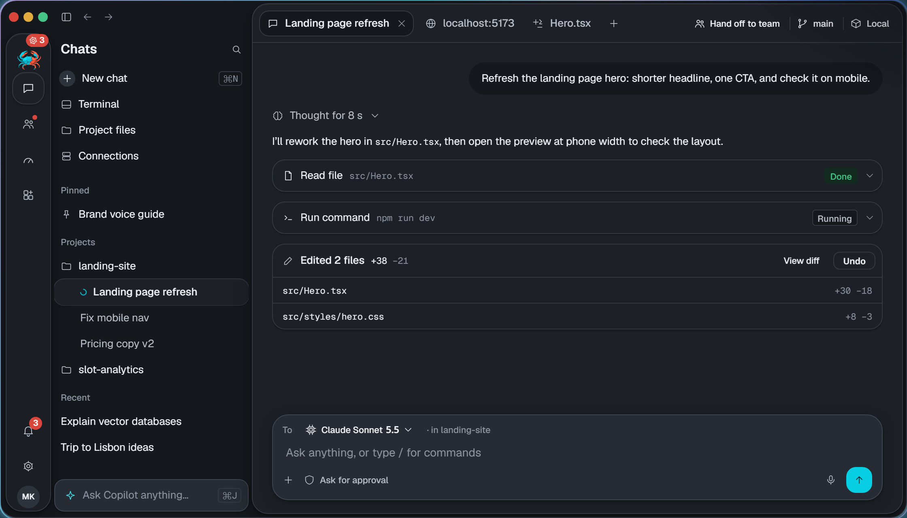
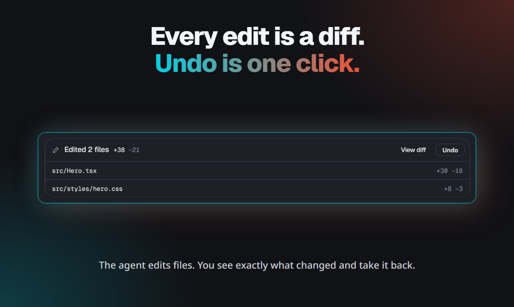
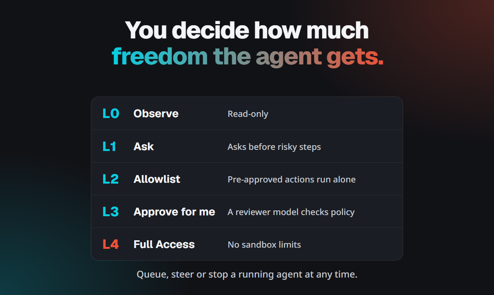
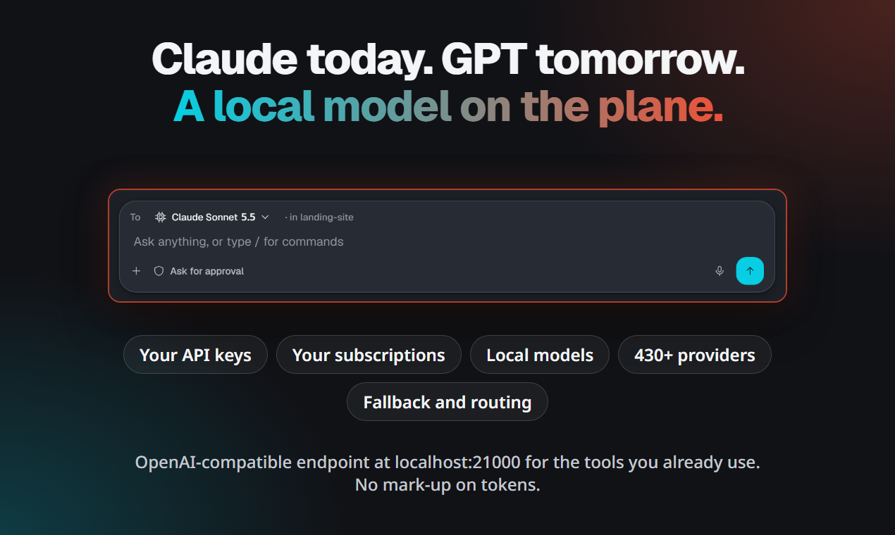
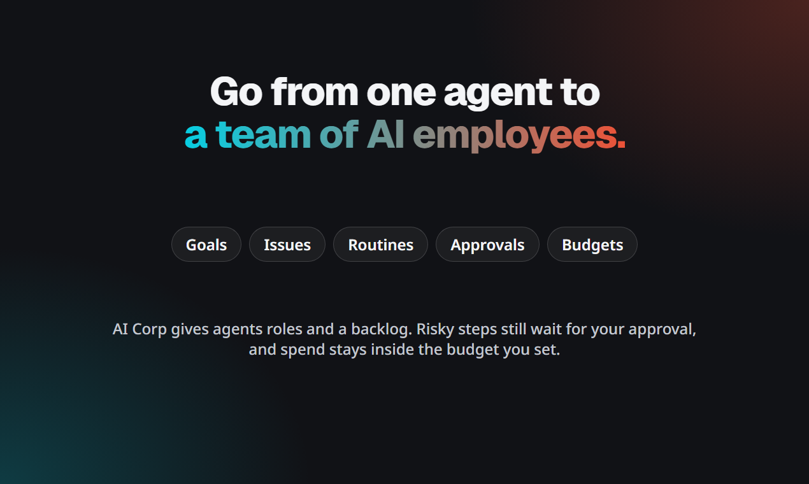
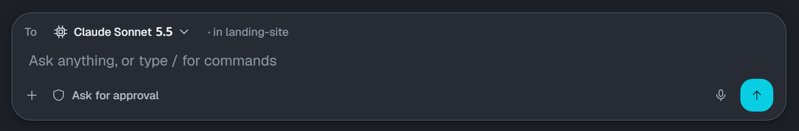

<p align="center">
  <a href="https://crabix.ai">
    
  </a>
</p>

<p align="center">
  <strong>The AI OneApp for managing AI agents.</strong><br>
  Give a task, choose how much freedom the agent gets, see every step, approve or stop it.<br>
  Runs on the models you already pay for. Mac, Windows, Linux.
</p>

<p align="center">
  <a href="https://crabix.ai"><strong>Website</strong></a>
  ·
  <a href="https://crabix.ai/download"><strong>Download</strong></a>
  ·
  <a href="https://crabix.ai/releases"><strong>Releases</strong></a>
  ·
  <a href="https://crabix.ai/llms.txt"><strong>LLM context</strong></a>
  ·
  <a href="https://discord.gg/XTzppGXdNQ"><strong>Discord</strong></a>
</p>

<p align="center">
  <a href="https://crabix.ai/releases"></a>
  <a href="https://crabix.ai/download"></a>
  <a href="https://crabix.ai/pricing"></a>
  <a href="LICENSE"></a>
</p>

<p align="center">
  <a href="https://crabix.ai/download/macos/aarch64/latest"></a>
  <a href="https://crabix.ai/download/macos/x86_64/latest"></a>
  <a href="https://crabix.ai/download/windows/x86_64/latest"></a>
  <a href="https://crabix.ai/download/windows/aarch64/latest"></a>
  <a href="https://crabix.ai/download/linux"></a>
  <a href="https://crabix.ai/download/linux"></a>
</p>



## What CrabiX is

Claude today, GPT tomorrow, a local model on the plane. Each AI tool brings its own model, its own bill and its own idea of what the agent may touch. CrabiX puts **one agent and one set of rules** on top of all of them.

- **One agent, any model.** Bring your API keys, subscriptions and local models. 430+ providers in the catalog, with routing, combo models and fallback. Switch models and the approvals, history and controls stay where they were.
- **You choose the freedom.** Every conversation has an autonomy level, from L0 Observe to L4 Full Access. Risky steps wait for your approval. Queue the next task, steer a running agent, or stop it.
- **Every edit is a diff.** Changes show up with lines added and removed, and Undo takes them back. The execution trail records tools, models and approvals.
- **From one agent to a team.** AI Corp runs AI employees with goals, issues, routines, approvals and budgets.
- **One workspace.** Chats, projects, terminal, Git, browser preview, MCP, skills, plugins and a marketplace next to the agent. Desktop, web and CLI are thin clients over one local backend.
- **Your keys, no markup.** Keys, prompts and configuration stay on your device by default. You pay providers directly.

## Screenshots

| Every edit is a diff | Autonomy levels |
| --- | --- |
|  |  |

| Any model you pay for | AI Corp |
| --- | --- |
|  |  |



## Autonomy levels

| Level | Name | What the agent may do |
| --- | --- | --- |
| L0 | Observe | Read only |
| L1 | Ask | Write to the project; risky steps need your approval |
| L2 | Allowlist | Pre-approved actions run on their own, everything else asks |
| L3 | Approve for me | A reviewer model checks each step against your policy |
| L4 | Full Access | No sandbox limits |

Company, device and temporary limits can set ceilings, and the lowest one wins.

## The gateway underneath

Under the agents is a local AI gateway with OpenAI, Anthropic and Ollama compatible APIs:

```text
http://localhost:21000/v1
```

Point other tools at it, or let **CrabiX Launch** connect Claude Code, Codex, VS Code, Cline, OpenCode and Continue to the same providers. The gateway has 14 routing strategies, combo models, fallback and usage accounting.

## Download

Release **26.10.24** is the first public release. Every platform below is signed and served from the stable channel.

| Platform | Download |
| --- | --- |
| macOS Apple Silicon | [`.dmg`](https://crabix.ai/download/macos/aarch64/latest) |
| macOS Intel | [`.dmg`](https://crabix.ai/download/macos/x86_64/latest) |
| Windows x64 | [installer](https://crabix.ai/download/windows/x86_64/latest) |
| Windows ARM64 | [installer](https://crabix.ai/download/windows/aarch64/latest) |
| Linux x86_64 | [AppImage](https://crabix.ai/download/linux/x86_64/appimage/latest) · [`.deb`](https://crabix.ai/download/linux/x86_64/deb/latest) · [`.rpm`](https://crabix.ai/download/linux/x86_64/rpm/latest) |
| Linux ARM64 | [AppImage](https://crabix.ai/download/linux/aarch64/appimage/latest) · [`.deb`](https://crabix.ai/download/linux/aarch64/deb/latest) · [`.rpm`](https://crabix.ai/download/linux/aarch64/rpm/latest) |

Checksums and signatures are in the [release feed](https://crabix.ai/release-feed.json). Verification steps: [docs/downloads.md](docs/downloads.md).

## Pricing

One plan, everything included: **$21/month** or **$189/year**, after a **7-day free trial**.

There is no free tier and no add-ons. Tokens are billed by your providers directly, CrabiX adds no markup. Payments go through Paddle as merchant of record ([refund terms](https://crabix.ai/refund)). After a trial without a subscription the app locks; your local data stays on disk.

## Security and privacy

Keys, prompts, project files, chat history and configuration stay on your machine by default. Cloud providers you choose still receive the requests you send them; use a local model when inference must stay on device. Details: [docs/security-local-first.md](docs/security-local-first.md).

Report vulnerabilities by email to [support@crabix.ai](mailto:support@crabix.ai), not in public issues. See [SECURITY.md](SECURITY.md).

## About this repository

The CrabiX app is closed source. This repository holds the public product facts, release and download guidance, issue templates, security policy and agent-readable context ([llms.txt](llms.txt)). Bug reports and feature requests are welcome in [Issues](../../issues).

## Links

- Website: [crabix.ai](https://crabix.ai) · [Download](https://crabix.ai/download) · [Releases](https://crabix.ai/releases) · [Pricing](https://crabix.ai/pricing)
- For agents: [llms.txt](https://crabix.ai/llms.txt) · [llms-full.txt](https://crabix.ai/llms-full.txt) · [agent-feed.json](https://crabix.ai/agent-feed.json) · [release-feed.json](https://crabix.ai/release-feed.json)
- Docs in this repo: [docs/README.md](docs/README.md)
- Legal: [Terms](https://crabix.ai/terms) · [Privacy](https://crabix.ai/privacy) · [Refund](https://crabix.ai/refund)

## Community

[Discord](https://discord.gg/XTzppGXdNQ) · [X](https://x.com/crabix_ai) · [YouTube](https://youtube.com/@crabix_ai) · [Reddit](https://www.reddit.com/r/Crabix/) · [Telegram channel](https://t.me/crabix_ai) · [Telegram chat](https://t.me/crabix_ai_chat) · [LinkedIn](https://www.linkedin.com/company/crabix-ai) · [Instagram](https://www.instagram.com/crabix_ai) · [Threads](https://www.threads.com/@crabix_ai) · [TikTok](https://www.tiktok.com/@crabix_ai) · [Facebook](https://www.facebook.com/people/CrabiX/61590486493714/)

## Company

CrabiX is operated by VISIONER PTE. LTD., UEN 202314121N, Singapore. Support: [support@crabix.ai](mailto:support@crabix.ai).

## License

Proprietary product materials, brand assets and screenshots. See [LICENSE](LICENSE).
